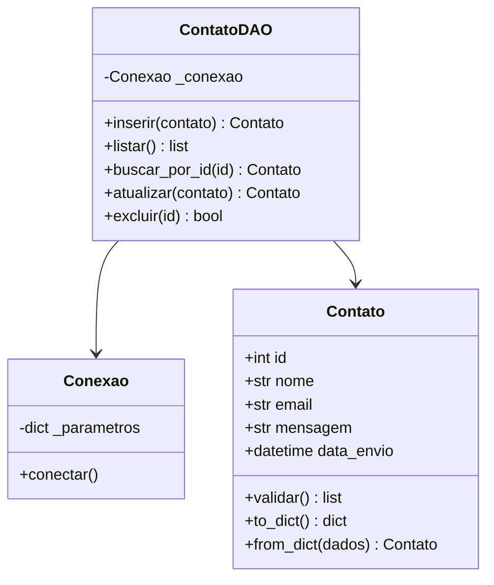

# Diagrama de classes — Tourly

A camada `routes/contato_routes.py` recebe as requisições HTTP, valida os dados por meio de `Contato` e delega a persistência ao `ContatoDAO`. `Conexao` centraliza a abertura das conexões MySQL.
